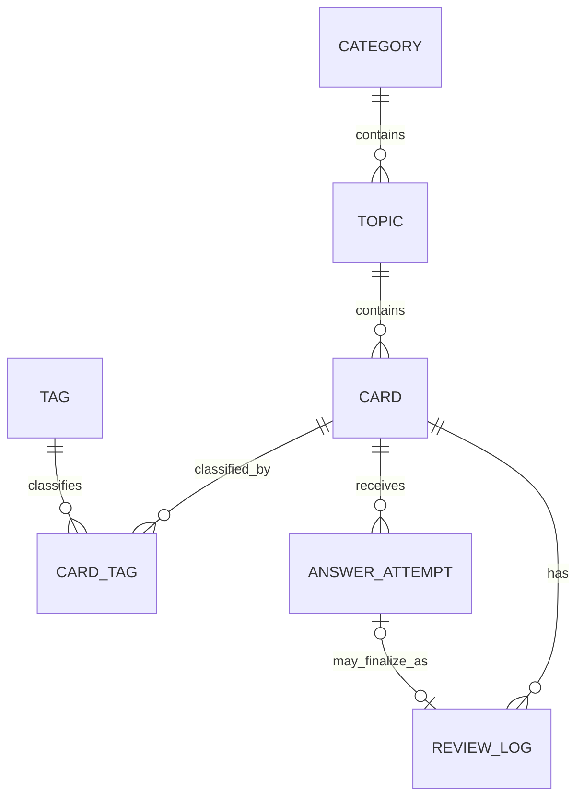

# Python Recall: архитектура системы

- Статус: рабочий архитектурный документ
- Версия: 0.1
- Дата: 2026-11-06

## Назначение документа

Документ фиксирует границы модулей, основные сущности и связи Python Recall.
Точные HTTP-контракты, формат ошибок, пагинация и правила представления дат
будут определены на этапе 0.3 в `api.md`.

Архитектура опирается на следующие решения:

- [ADR-001](adr/ADR-001-review-algorithm.md) — алгоритм повторений;
- [ADR-002](adr/ADR-002-entity-lifecycle.md) — жизненный цикл сущностей;
- [ADR-003](adr/ADR-003-frontend-architecture.md) — архитектура Frontend;
- [ADR-004](adr/ADR-004-ai-architecture.md) — архитектура AI-модуля Release 3.

## Архитектурные границы

Проект состоит из двух самостоятельных приложений:

- `backend` — FastAPI, бизнес-логика, SQLAlchemy, PostgreSQL и интеграции с AI;
- `frontend` — React-клиент, работающий только через REST API.

Backend организован по функциональным модулям:

| Модуль | Ответственность |
|---|---|
| `categories` | Категории верхнего уровня |
| `topics` | Темы внутри категорий |
| `cards` | Учебные карточки и их теги |
| `reviews` | SM-2, очередь и история повторений |
| `statistics` | Производные показатели без отдельного источника истины |
| `ai` | Необязательные AI-сценарии, начиная с Release 3 |

Направление зависимостей внутри каждого модуля:

```text
router -> schema -> service -> model/repository -> database
                     |
                     +-> pure domain algorithm
```

HTTP-слой не содержит бизнес-правил. ORM-модели не вызывают сервисы. Алгоритм
SM-2 остаётся чистой функцией и не зависит от FastAPI, SQLAlchemy, времени или
AI.

## Объём модели Release 1

В первую миграцию входят только core-сущности:

- `categories`;
- `topics`;
- `cards`;
- `tags`;
- `card_tags`;
- `answer_attempts` без результатов AI;
- `review_logs`.

Таблицы AI-предложений, оценок и использования провайдеров не создаются заранее.
Они будут спроектированы и добавлены миграциями вместе со сценариями Release 3.

Отдельная таблица статистики и сущность сохранённой review-сессии в Release 1
не нужны. Статистика вычисляется по карточкам и истории, а очередь сессии
формируется сервисом повторений.

## Доменная модель Release 1



Все идентификаторы являются UUID. В Release 1 они генерируются приложением как
UUIDv4. Все моменты времени хранятся PostgreSQL в `TIMESTAMPTZ` и нормализуются
в UTC.

### Category

Категория представляет верхний уровень организации знаний.

| Поле | Смысл |
|---|---|
| `id` | UUID категории |
| `name` | Отображаемое имя, до 100 символов |
| `description` | Необязательное описание |
| `created_at` | Время создания |
| `updated_at` | Время последнего изменения |

Имя обязательно после удаления внешних пробелов. Имена категорий уникальны без
учёта регистра.

### Topic

Тема всегда принадлежит ровно одной категории. Вложенных подтем в Release 1 нет.

| Поле | Смысл |
|---|---|
| `id` | UUID темы |
| `category_id` | Обязательная ссылка на категорию |
| `name` | Отображаемое имя, до 100 символов |
| `description` | Необязательное описание |
| `created_at` | Время создания |
| `updated_at` | Время последнего изменения |

Имя темы уникально без учёта регистра в пределах категории. Тему можно перенести
в другую категорию, если там нет темы с таким именем.

### Card

Карточка является самостоятельной единицей знания и всегда принадлежит одной
теме.

| Поле | Смысл |
|---|---|
| `id` | UUID карточки |
| `topic_id` | Обязательная ссылка на тему |
| `question` | Вопрос в Markdown |
| `answer` | Эталонный ответ в Markdown |
| `explanation` | Необязательное пояснение в Markdown |
| `code_example` | Необязательный пример Python-кода |
| `difficulty` | `beginner`, `intermediate` или `advanced` |
| `is_archived` | Исключена ли карточка из обучения |
| `repetitions` | Число последовательных успешных повторений |
| `interval_days` | Текущий интервал в календарных днях |
| `ease_factor` | Десятичный коэффициент SM-2 |
| `next_review_at` | Следующий срок; `null` у новой карточки |
| `last_reviewed_at` | Последнее подтверждённое повторение |
| `created_at` | Время создания |
| `updated_at` | Время последнего изменения |

Начальные значения состояния SM-2 определены ADR-001. `ease_factor` хранится
десятичным типом, чтобы двоичная погрешность не меняла округление интервалов.

Редактирование текста, перенос в другую тему и изменение тегов не сбрасывают
SM-2 автоматически. Автоматический сброс затруднил бы прогнозирование изменений
и мог бы уничтожить полезную историю без явного решения пользователя.

### Tag и CardTag

Тег классифицирует карточки независимо от дерева категорий и тем.

| Сущность | Поля и ограничения |
|---|---|
| `Tag` | `id`, уникальное без учёта регистра `name` до 50 символов, `created_at` |
| `CardTag` | Составной ключ (`card_id`, `tag_id`), `created_at` |

Повторная связь той же карточки и тега запрещена составным первичным ключом.

### AnswerAttempt

Попытка хранит введённый пользователем ответ независимо от итоговой оценки.

| Поле | Смысл |
|---|---|
| `id` | UUID попытки |
| `card_id` | Карточка, на которую дан ответ |
| `user_answer` | Непустой текст ответа пользователя |
| `created_at` | Время отправки ответа |

Пользователь может оценить карточку без сохранённой попытки, например при устном
или мысленном ответе. Попытка также может существовать без `ReviewLog`, если
пользователь запросил анализ, но не завершил повторение.

Поля `ai_score`, `correctness`, `completeness`, обратная связь и сведения о
провайдере не входят в core-таблицу. Начиная с этапа 3.2 результаты хранятся в
отдельной `answer_evaluations`, допускающей повторный анализ одной попытки.

### ReviewLog

`ReviewLog` — неизменяемый факт подтверждённого пользователем повторения.

| Группа полей | Содержимое |
|---|---|
| Идентификация | `id`, `card_id`, необязательный уникальный `answer_attempt_id` |
| Оценка | `rating`, соответствующее числовое `quality` |
| Прежнее состояние | repetitions, interval, ease factor и next review |
| Новое состояние | repetitions, interval, ease factor и next review |
| Время | `reviewed_at`, `created_at` |
| Идемпотентность | уникальный `idempotency_key`, `request_fingerprint` |

`rating` принимает `again`, `hard`, `good`, `easy`; `quality` сохраняет
фактически применённое значение `q`. Хранение обеих величин делает историю
самодостаточной даже при будущем изменении отображения UI.

Связь с `AnswerAttempt` необязательна и уникальна: одна попытка может завершить
не более одного повторения. Сервис обязан проверить, что попытка и повторение
относятся к одной карточке.

## Связи и ссылочная целостность

| Родитель | Потомок | Кардинальность | Поведение FK при удалении |
|---|---|---:|---|
| Category | Topic | 1:N | `RESTRICT` |
| Topic | Card | 1:N | `RESTRICT` |
| Card | CardTag | 1:N | `CASCADE` |
| Tag | CardTag | 1:N | `CASCADE` |
| Card | AnswerAttempt | 1:N | `RESTRICT` |
| Card | ReviewLog | 1:N | `RESTRICT` |
| AnswerAttempt | ReviewLog | 1:0..1 | `RESTRICT` |

`CASCADE` используется только для технической таблицы many-to-many. Удаление
пользовательских знаний и истории не должно неявно распространяться по дереву.

## Транзакционные границы

Следующие операции атомарны:

- создание или изменение карточки вместе с полным набором её тегов;
- удаление сущности вместе с допустимыми техническими связями `card_tags`;
- подтверждение повторения: проверка идемпотентности, обновление Card и создание
  ReviewLog;
- принятие AI-предложения в будущем, но только после проектирования Release 3.

Текст ответа и AI-анализ не входят в транзакцию подтверждения повторения, что
зафиксировано ADR-001.

## Архивация и удаление

Архивация поддерживается только для карточек. Она обратима и не изменяет историю
или состояние SM-2. Категории и темы удаляются только пустыми; карточка с
историей не удаляется физически. Полные правила и причины описаны в ADR-002.

## Индексы Release 1

Помимо первичных ключей и FK предусматриваются:

- уникальный индекс на регистронезависимое имя категории;
- уникальный индекс на (`category_id`, регистронезависимое имя темы);
- уникальный индекс на регистронезависимое имя тега;
- индекс `topics.category_id`;
- индекс `cards.topic_id`;
- индекс очереди по `cards.next_review_at` для неархивных карточек;
- индекс `answer_attempts(card_id, created_at)`;
- индекс `review_logs(card_id, reviewed_at)`;
- индекс `review_logs.reviewed_at` для статистики активности;
- уникальный индекс `review_logs.idempotency_key`.

В Release 1 фильтр `search` выполняет регистронезависимый поиск подстроки по
вопросу, ответу и пояснению. Полнотекстовый индекс и правила токенизации можно
добавить отдельным архитектурным решением при появлении измеримой необходимости.

## Расширение в Release 3

AI-модуль расширяет core-модель последовательными миграциями. Этап 3.2 добавил:

- `ai_requests` — состояния и ключи идемпотентных AI-команд;
- `answer_evaluations` — неизменяемые результаты и входные снимки, связанные с
  `AnswerAttempt` через `RESTRICT`;
- `ai_usage_logs` — provider, model, токены, длительность, статус и безопасный
  код ошибки без prompt и пользовательского ответа.

Один `AnswerAttempt` может иметь несколько анализов, но один `ai_request` — не
более одного результата и одной usage-записи. Сначала команда фиксируется как
`pending`, затем успешный результат, usage и переход в `succeeded` сохраняются
одной транзакцией. Ошибка переводит команду в `failed` и сохраняет только
безопасные технические метаданные.

`card_analyses` и `ai_suggestions` появятся отдельными миграциями вместе с
соответствующими сценариями. AI-сущности не могут каскадно изменять или удалять
Card, ReviewLog и AnswerAttempt.

Точные границы provider/scenario/persistence, правила structured output,
идемпотентности и постепенного добавления таблиц определены в ADR-004. План
последовательной реализации описан в [плане Release 3](release-3-plan.md).

## Зафиксированный контракт Release 1

Раздельное сохранение ответа и подтверждение повторения, идемпотентность,
пагинация, ошибки, фильтры, UTC-сериализация и запрещённые операции определены в
[REST API](api.md), [ADR-001](adr/ADR-001-review-algorithm.md) и
[ADR-002](adr/ADR-002-entity-lifecycle.md). Изменения этих правил требуют
обновления контракта и соответствующих тестов до изменения реализации.
